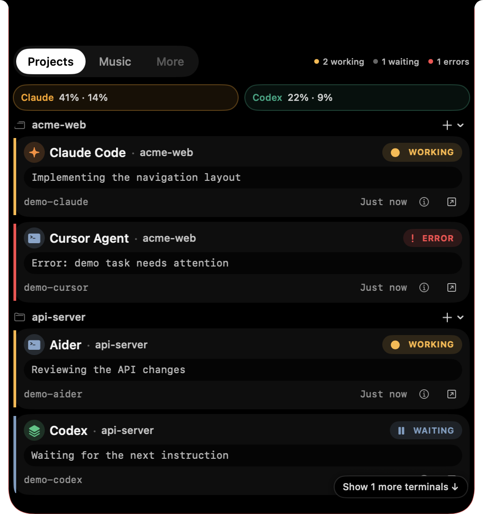
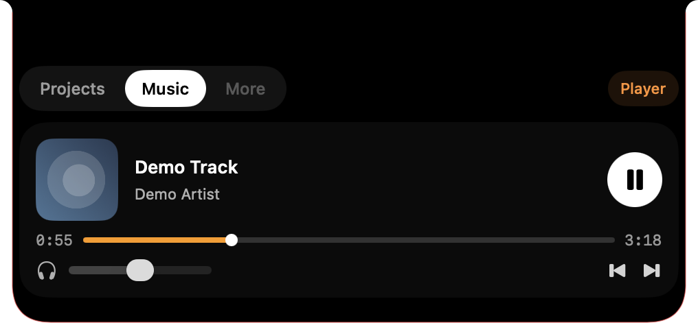
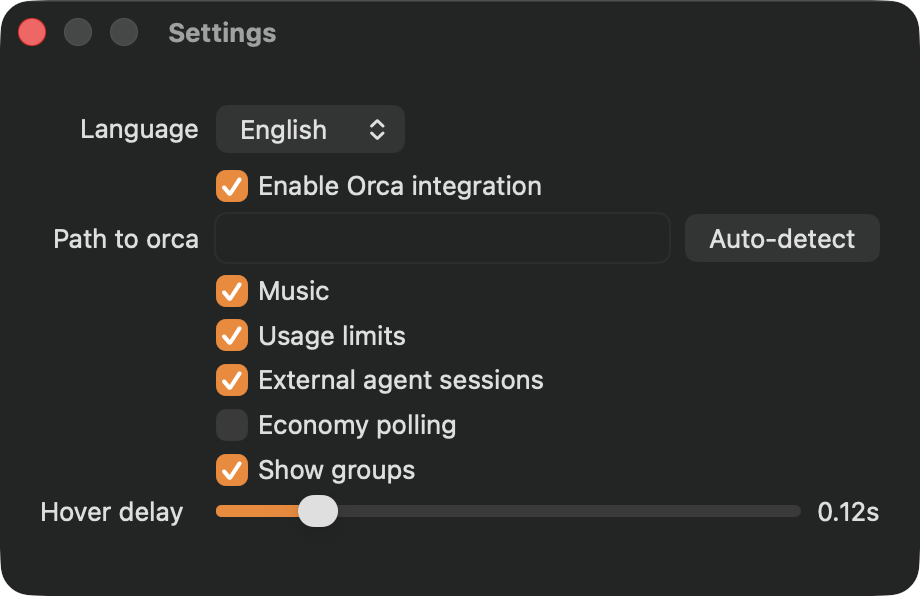
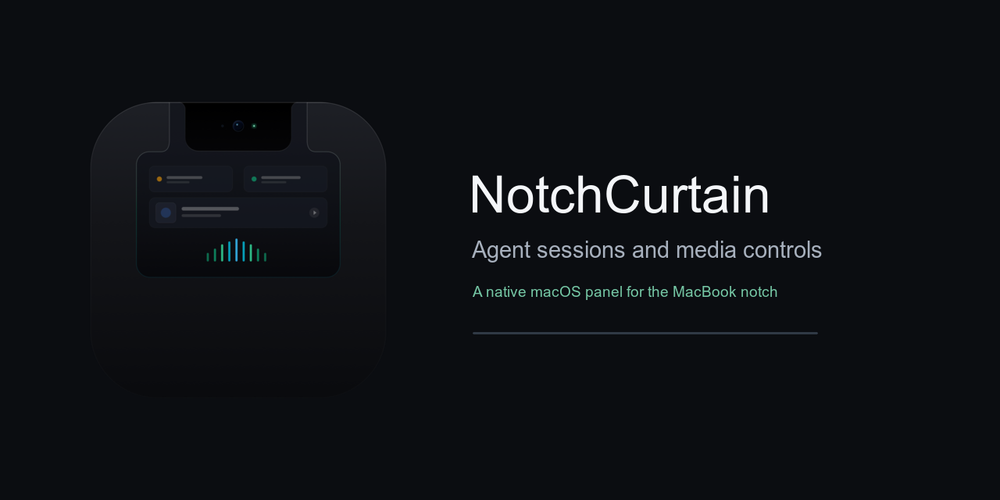

# NotchCurtain

**A small native macOS panel for agent sessions and media controls, attached to the MacBook camera notch.** It stays collapsed until you hover over the notch and expands to show local session status, usage limits when available, and Now Playing controls.

[](https://www.apple.com/macos/)
[](https://swift.org)
[](LICENSE)

[Русская версия](README.ru.md) · [Features](#features) · [Installation](#installation) · [Privacy](#privacy) · [Settings](#settings) · [Roadmap](#roadmap)

## Preview

| Agent sessions | Music | Collapsed music capsule |
|:--:|:--:|:--:|
|  |  |  |




## Features

- **Orca sessions:** shows terminals, agent status, project, and available session details from the local Orca CLI.
- **External sessions:** scans process names for `claude`, `codex`, `gemini`, `cursor-agent`, `aider`, `opencode`, and `copilot`; uses `ps` and `lsof` to find processes and working directories. Claude and Codex session-log modification times may help determine activity. This scanner does not discover every agent or every application.
- **Usage limits:** reads providers returned by `orca account list --json`. Codex can also be read from the local `codex app-server` rate-limit API. Claude limits are shown only when Orca returns Claude rate-limit data; NotchCurtain has no separate Claude quota source.
- **Music:** displays macOS Now Playing metadata, artwork, progress, and transport controls through the bundled `mediaremote-adapter`.
- **Local preferences:** language, Orca integration and executable path, music, usage limits, external sessions, economy polling, workspace grouping, and hover delay.
- **English and Russian interface.**

Features that are not implemented are not implied by these screenshots. See [Roadmap](#roadmap) for planned work.

## Installation

Install with Homebrew:

```sh
brew install --cask kaTrek0406/tap/notch-curtain
```

The project does not currently include a signed and notarized release. If macOS blocks a locally built or downloaded ad-hoc signed app, use Finder's **right-click → Open** flow, or remove quarantine from that app:

```sh
xattr -dr com.apple.quarantine /Applications/NotchCurtain.app
```

## Requirements

- macOS 14 or newer.
- **Apple Silicon (arm64) only.** The released app is not a universal binary and does not run natively on Intel Macs.
- MacBook with a physical camera notch. The panel controller looks for a display with a top safe-area inset and notch geometry; on a Mac or display without a notch, it returns without creating the panel. There is no simulated notch fallback.
- Xcode Command Line Tools and CMake for building.

## Privacy

NotchCurtain does not use `URLSession` or `URL(string:)` and the app source contains no HTTP client. It obtains information locally:

| Data | Local source |
|---|---|
| External agent processes and working directories | `/bin/ps` and `/usr/sbin/lsof` |
| Claude/Codex activity hint | Local session-log file modification dates and sizes |
| Orca sessions, workspaces, and optional provider limits | Local `orca` CLI commands |
| Codex limits | Local `codex app-server --listen stdio://` JSON-RPC |
| Current media and controls | `mediaremote-adapter` local bridge to macOS Now Playing |

The app does not scan `.env` files or API keys. Orca's terminal listing can include terminal preview text, which is displayed in the panel. The media adapter relies on Apple's private MediaRemote interface through a system Perl process. It is not suitable for the Mac App Store and may stop working after a macOS update.

Measured CPU on the development machine was approximately **0.17% while idle** and **1.06% with a fake track playing in the collapsed capsule**. These are single-machine measurements, not performance guarantees.

## Settings

Open **Settings…** from the menu bar item. Available options are language, Orca integration and CLI path, music, usage limits, external agent sessions, economy polling, workspace grouping, and hover delay. Settings are stored locally at `~/Library/Application Support/NotchCurtain/settings.json`.

## Build and test

```sh
brew install cmake
swift test
./scripts/build_app.sh
```

The app bundle is built under `.build/NotchCurtain.app`. To install and launch the build, use `./scripts/install.sh`; this changes the local installation, so launch the bundle in `.build` directly when you only want to inspect it. The package script creates archives under `dist/`.

The privacy source check is `./scripts/privacy_check.sh`.

### Screenshot demo

Run the isolated demo data mode with:

```sh
NC_DEMO=1 NOTCH_CURTAIN_SETTINGS_PATH=/tmp/notch-curtain-demo-settings.json .build/NotchCurtain.app/Contents/MacOS/NotchCurtain
```

It uses fabricated sessions, limits, and a generated cover image. It does not poll Orca, the process table, session files, or Now Playing. See [CONTRIBUTING.md](CONTRIBUTING.md) for details.

## Roadmap

Planned, not implemented:

- Focus timer.
- Calendar and AirPods status.
- Quick notes.
- File shelf.

Social preview: 

## Contributing and license

See [CONTRIBUTING.md](CONTRIBUTING.md), [CODE_OF_CONDUCT.md](CODE_OF_CONDUCT.md), and [SECURITY.md](SECURITY.md). NotchCurtain is licensed under the [MIT License](LICENSE); third-party notices are in [THIRD_PARTY.md](THIRD_PARTY.md).
